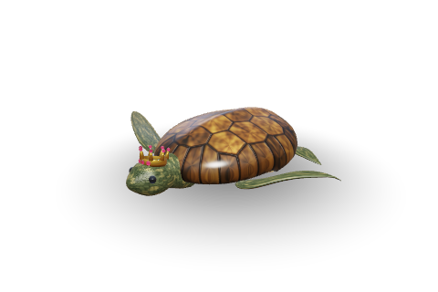
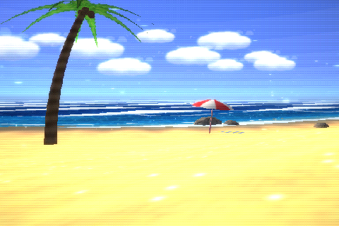
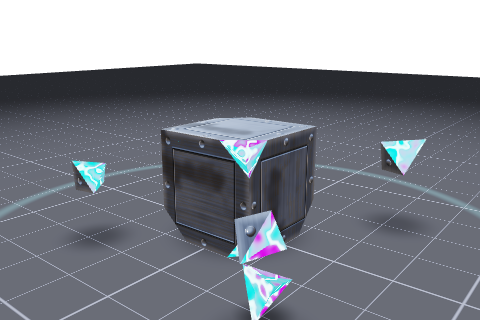
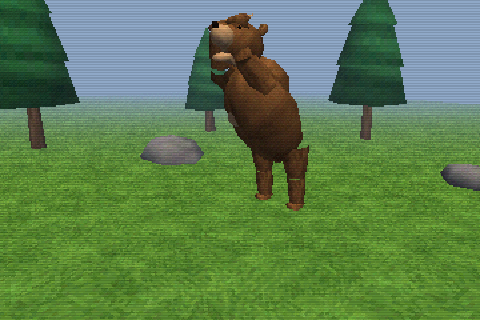
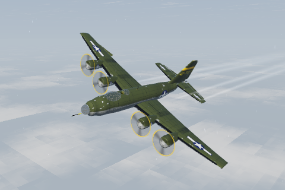
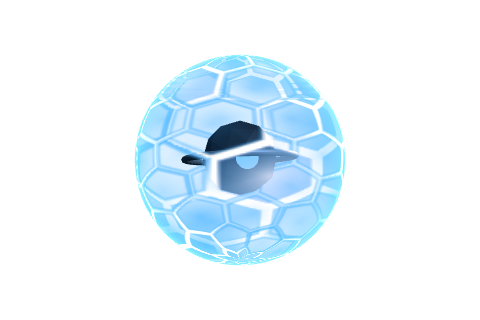
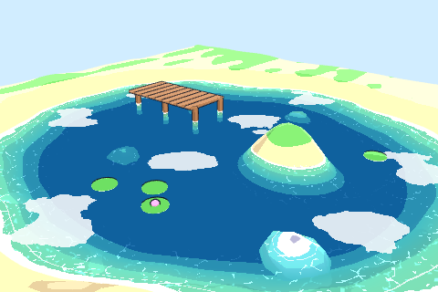

# Project-TheCreator

A prompt → asset system. Each request (a prompt for an object, scene, animation, shader, texture or font) becomes a
**bundle**: a versioned folder of real files (meshes, textures, GLSL shaders, scene graphs, particles, baked animation,
fonts, previews), catalogued in SQLite with hashes and dependency edges, and shown in a web studio.

```bash
python3 server.py            # http://localhost:4747  (seeds the 3 examples on first run)
python3 cli.py --help        # seed · list · info · request · inbox · rescan · regen · integrity
```

It needs only the Python 3.9+ standard library. The browser loads three.js and Google Fonts from a CDN.

| | | | |
|:-:|:-:|:-:|:-:|
| <br>Crowned Sea Turtle | <br>PS2 Beach | <br>Shatter Cube Loop | <br>PS2/PS1 Bear |
| <br>Turbulence Bomber | <br>Hex Energy Shield | <br>Toon Water Shader | |

## Getting the creations

The vault (`vault/`, `thecreator.db`) is local data and is not in git. A fresh clone seeds the three founding examples on
first start. Every finished creation is published as a ZIP on the
[**creations** release](https://github.com/ecogamezz/Project-TheCreator/releases/tag/creations), with its files plus a
`project.json` record. Pull any of them into your vault:

```bash
python3 cli.py import https://github.com/ecogamezz/Project-TheCreator/releases/download/creations/animation.zip
```

Publish your own (needs the GitHub CLI, `gh auth login`):

```bash
python3 cli.py publish animation-ps2 toon-water-shader-stylized   # selected creations
python3 cli.py publish --all                                      # everything that is ready
```

## Layout

```
server.py              REST API + static web app
cli.py                 command line for the vault
thecreator.db          SQLite catalogue: projects, assets, dependencies, tags, folders, versions, activity
vault/projects/<slug>/ one bundle per request: manifest.json + meshes/ textures/ shaders/ materials/ scenes/ ...
vault/inbox/           tickets for queued prompts that are waiting for a generator
creator/               store (DB + vault), prompt interpreter, procedural toolkit, the 3 generators
web/                   app shell, library, studio, vault explorer, WebGL engine
```

## The three founding requests

| Bundle | What was generated |
|---|---|
| **Crowned Sea Turtle** (object) | 13,498 / 15,000-tri hero mesh plus LOD1/LOD2 (OBJ + MTL + glTF). Procedural scute, skin, plastron and crown textures with normal and roughness maps. Five GLSL programs, including a swim stroke in the vertex shader. Gold, silver and jade crown variants. |
| **Sunny Shores · PS2 Beach** (scene) | Terrain, Gerstner-wave ocean, palms, rocks, umbrella and towel. 128px textures with Bayer dithering. Gouraud vertex lighting, fog, banded sky, billboard clouds. Three wind particle systems (streaks, sand drift, sea spray). A 640×448 post pass (glow, 16-bit dither, interlace) and a bitmap HUD font (BDF + atlas). Noon, sunset and night variants, plus PS1 and HD output modes. |
| **Shatter Cube Loop** (animation) | A pre-fractured metal cube: a body plus 8 jagged corner shards with sealed sockets. A 60 fps bake: crouch → jump with a 360° flip → impact. On impact there is a white texture flash and 5 shards break off with physics, showing an iridescent core colour inside. The shards settle, fade, and grow back into their sockets, so the loop has no seam. Exported as anim JSON (with flash, glow and shake channels) and glTF. Steel, copper and obsidian skins; prism, toxic and ember cores. |

## Workflow for new prompts (how the queue gets done)

1. **Queue.** Enter a prompt in the UI (Forge or **N**) or run `cli.py request "…"`. The interpreter turns it into a spec
   and a pipeline plan, and writes a ticket to `vault/inbox/<slug>.request.json`.
2. **Generator.** Each kind of creation has a generator in `creator/gen_*.py`, plus an optional viewer in `creator/runtime/`.
   `creator/generators.py` decides which generator takes which prompt (`MATCHERS`). For a new kind of request, ask Claude:
   *"Process the TheCreator inbox."* Claude reads the tickets, writes the missing generators and registers them.
3. **Process.** Click **Vault explorer → Inbox → Process queue**, or run `python3 cli.py process`. Every queued request that has a
   matching generator is built, hashed, catalogued, versioned and tagged, and its ticket is closed. Requests without a
   generator wait in the inbox.
4. **Manual delivery.** You can also drop files into the project folder or onto its card, then click **Rescan**.

Bundles can ship their own real-time viewer (`render.type = "module"`, `runtime/viewer.js`). The studio picks up the
viewer's controls, clips, timeline and variants automatically, so a new kind of creation needs no engine changes.

| Generator | Bundle |
|---|---|
| `gen_bear` | PS2 bear: 12-bone rigid-part rig, 1,134 tris, 64px dithered textures. Idle/walk/run/attack/death at 30 fps with a state machine and crossfades. PS1 vertex snapping, affine UVs and vertex glitches. glTF with hierarchy and 5 clips. |
| `gen_bomber` | Heavy bomber: 71,348 / 90,000 tris plus LOD1. Moving control surfaces, props, bay doors. 4 baked flight clips (calm, turbulence, storm, evasive) with gusts and lightning. Paint, glass and prop-blur shaders, wing flex, a cloud-deck sky, contrails, streaks. |
| `gen_shield` | Hex energy shield: 24-frame loop, seamless in space and time, RGBA flipbook plus animated PNG, flipbook and live GLSL shaders. |
| `gen_toonwater` | Toon water shader: depth pre-pass thickness bands, intersection foam, refraction, caustics, cel-shaded pond diorama with live sliders. |
